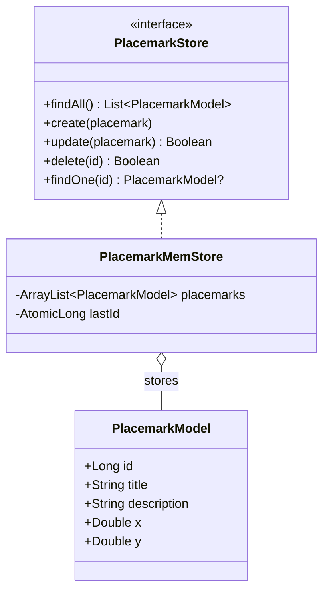

# Lab 1 data model

The model, store interface and memory implementation follow the Lab 1 architecture. `x` and `y` use the coordinate defaults from its model example. The console runner is a set of top-level functions in `main/Main.kt`.

